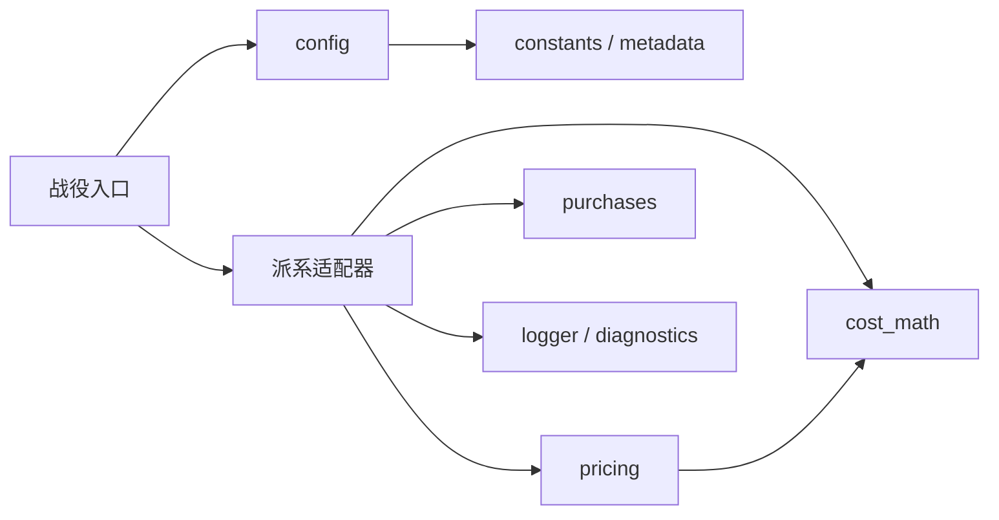

# 架构

模组由战役入口、派系适配器、MCT 页面和 Python 构建工具组成。身份与版本来自 `data/project.json`，其中 `mod_id` 是模组标识，`mod_key` 是 MCT 注册键。

## 运行时模块

战役入口为 `src/script/campaign/mod/tww3_mod_capacity_cost_control_main.lua`。内部模块位于 `src/script/campaign/capacity_cost_control/`，使用短文件名；自动加载入口保留唯一文件名。

| 模块 | 职责 |
|------|------|
| `main.lua` | 加载适配器，响应 MCT 初始化、配置变更和通用仪式事件 |
| `adapters/` | 五个派系的事件、历史恢复规则、费用 bundle 与军队容量同步 |
| `config/settings.lua`、`config/constants.lua` | MCT 设置读取、费率解析、固定标识与默认值 |
| `shared/pricing.lua` | 按基础费用、次数和费率向 bundle 添加费用效果 |
| `store/purchases.lua` | 恢复缺失记录、读取和写入成功购买次数 |
| `store/migration.lua` | 导入旧版 MCT 设置和购买次数，保留已有新版记录与旧数据 |
| `utils/cost_math.lua` | 纯整数费用计算、原版递增抵消与 float32 补偿 |
| `utils/logger.lua`、`utils/diagnostics.lua` | 日志写入与紫晶面板只读诊断 |

Campaign 模块通过 `core:load_global_script("capacity_cost_control.config.settings")` 加载，原版加载器将点号转换为目录。入口在首 tick 和 MCT 变更后刷新设置，购买后的延迟刷新等待原版监听器完成。

## 派系计价与历史

| 适配器 | 费用来源与处理 | 购买记录 |
|--------|----------------|----------|
| `nagash.lua` | 保留原版 DB 递增，用 post modifier 调整到目标费用；`nagash_sigils.lua` 调整亡灵术进度贡献 | 读取原版 `get_tracked_cost_uses` |
| `chaos_dwarfs.lua` | hook `hellforge.modify_ritual_cap_cost`，复用原版费用 bundle | 设置变化时读取原版容量 bundle 重算 |
| `beastmen.lua` | 保留原版复利效果，在独立 bundle 中抵消后应用线性费率 | 首次按可核实的复利记录恢复，之后保存成功购买次数 |
| `amethyst.lua` | 四项仪式的 DB 自动递增归零，通过 `pricing` 直接计价 | 独立监听购买并存档，首次导入可读的原版次数 |
| `shangyang.lua` | 兵种和军队容量仪式的 DB 自动递增归零，复用 `pricing` | 独立保存次数；军队项目同时从已有容量恢复并同步容量效果 |

五个派系的基础费用倍率默认 `100%`，此值不增加基础缩放运算；`0%` 使用精确免费修正。其余值在既有增长倍率及上限计算之后缩放目标费用，即 `基础费用 × 基础倍率 × 购买增长倍率`，费用取整与 float32 补偿保持原规则。混沌矮人从当前费用效果折算为 `(100 + 增长修正) × 基础倍率 - 100`，不复制基础费用表。

混沌矮人原版价格控件通过支出 transaction 更新文字，零费用缺少该上下文时会残留模板占位值 `99`。适配器在面板打开、设置刷新和购买后延迟补零，仅修改本地玩家启用 `0%` 覆盖时的容量价格文字；付费价格仍由原版更新，不覆盖整份原版 UI 文件。

纳迦什独立的亡灵术进度倍率默认 `100%`。`nagash_sigils` 包装 `core.event_listeners.RitualAboutToStartEvent` 中已注册的原版 `BlackPyramid_RitualCompletedEvent_UnitCapSigils` 回调，只将本次支出替换为完整原版费用乘进度倍率的等价值，复用原版门槛、符印及状态写入。费用基准使用原版费率、上限与当前购买次数，和玩家费用设置无关；免费购买即使没有支出接口也能贡献进度。AI、无 MCT、关闭覆盖和列表之外的仪式直接调用原回调，不新增存档字段。

`shared/pricing` 接收记录和次数，`utils/cost_math` 处理整数取整与 float32 边界。纳迦什、紫晶和上阳诸军按原版费率与最大递增次数限制目标费用。

`store/purchases` 提供 `get_or_import(save_key, records, recover_count)` 与 `record_purchase(save_key, ritual_key)`。只为缺失记录调用恢复回调，保留已存的零值和计数；各派系的恢复依据留在适配器。野兽人可在首次导入前记录购买，紫晶和上阳诸军先恢复历史再累加。

读取购买记录时先由 `store/migration` 补入旧版 `wh3_ccc_*` 计数，上阳诸军将 `bhashiva` 映射到 `shangyang`。入口注册存档加载回调，读取 `mct_registry` 中旧身份的选项；MCT 完成加载后，只恢复新版存档中缺失的设置。迁移不删除旧记录，也不修改容量或库存。

玩家覆盖依赖 MCT。关闭覆盖、无 MCT 或 AI 使用原版费用；紫晶与上阳诸军仍由脚本维护原版曲线，因为它们的 DB 自动递增已归零。这两个适配器的购买监听独立于入口，并在首 tick 刷新；上阳诸军还处理失败军队仪式可能写回的旧容量。

上阳诸军在仪式元数据和现有选项键中仍使用 `bhashiva`。旧档无法核实的购买历史从零基线接入；紫晶和上阳诸军的新历史依赖模组存档计数。

## MCT 与诊断

设置入口为 `src/script/mct/settings/tww3_mod_capacity_cost_control_mct.lua`，通过 `loadfile` 加载常量、生成元数据、双语文本和布局模块。

设置入口向 `layout` 与 `links` 显式传入 `core`、`find_uicomponent`、`common` 和 `cco`；通过 `loadfile` 加载的辅助模块及延迟 UI 回调不再依赖战役中缺失的全局接口。

`src/script/mct/capacity_cost_control/layout.lua` 替换当前设置页的 `populate`，复用 MCT 控件：左列按常量顺序放五个派系，右列放诊断和其它设置。链接按创意工坊、参与贡献排序。地址留空时，链接按钮只显示提示，不注册跳转回调。

`src/script/mct/capacity_cost_control/links.lua` 为按钮绑定独立的 `CcoScriptObject` URL；`src/ui/tww3_mod_capacity_cost_control/` 中的原生控件模板通过 `ContextCommandLeftClick` 执行 `OpenOverlayToUrl(StringValue, true)`。两个模板分别保留游戏文本按钮和 MCT 图标按钮的外观。首页渲染后替换本项目图标、移除旧监听，并使用模组专属 ID；MCT 切页会销毁旧控件，重开后重新绑定。

原生控件的创意工坊链接已获用户确认可用；GitHub 直达在两种布尔参数下均无导航。本机引擎 `OpenOverlayToUrl` 的静态调用链对 `steamcommunity.com`、`www.totalwar.com` 有专门分支，其余地址经过额外允许列表检查。目前未找到可供 Lua 使用的注册接口。因此仅将 GitHub 导航目标转换为 Steam 官方 `linkfilter/?u=` 确认页，并逐字节编码目标 URL；工坊地址与项目元数据保持原始值。用户需要在确认页点击继续访问 GitHub。用户已在游戏中确认此路径可正常访问 GitHub。

诊断默认关闭。紫晶面板遍历在开关启用后执行；日志使用 `get_timestamp()`，写入元数据指定的游戏根目录文件。日志打开失败时返回。

## 数据与构建

| 真源 | 构建用途 |
|------|----------|
| `data/project.json` | 生成 `config/metadata.lua`，供运行时和 MCT 读取同一身份 |
| `data/rituals.json` | 生成 `shared/generated_data.lua`、effect、仪式效果关联和 bundle TSV |
| `i18/en.json`、`i18/zh.json` | 生成 `shared/i18.lua` |
| `data/amethyst_rituals.tsv`、`data/bhashiva_rituals.tsv` | 覆盖紫晶与上阳诸军仪式的 DB 自动递增字段 |
| `src/` | 原样加入 pack，包括人工维护的 Lua 常量 |

`script/build/build_mod.py` 将生成文件写入 `build/generated/`，再通过 `script/build/rpfm_mcp.py` 交给 RPFM 导入 DB、添加 Lua 并保存 pack。输出为 `build/tww3_mod_capacity_cost_control.pack` 及同名 PNG；PNG 从 `logo.png` 复制，供启动器显示图标。pack 声明 MCT 为可选依赖。

`script/ci/verify.py` 分别运行模组测试和工具测试，默认包含 RPFM 构建；`--skip-pack` 只跳过打包。环境与命令见[开发指南](docs/development.zh-CN.md)。

`.github/workflows/release.yml` 接收版本号，必要时通过版本 PR 和获批的 PR Verify 更新 `data/project.json`，再固定到已合并提交运行完整验证与云端 RPFM 构建，保存 pack、同名 PNG 和两者的校验和。维护者在 `release-approval` 审批后，才由独立发布 job 推送 tag、上传 Steam 并公开附带该 pack 的 GitHub Release。`CHANGELOG.md` 保存各版本中英文说明；`script/ci/release_notes.py` 原文提取对应版本，作为独立 artifact 等待审批，供 GitHub Release 和工坊共用。`script/ci/prepare_release.py` 约束版本与 tag；`upload_workshop.py` 校验获批产物并更新既有工坊条目。MCT 原生版本、工坊与 GitHub 链接也读取同一份包内元数据。

生成文件存放于 `build/generated/`，按上表映射打包到模块目录。MCT 通过完整 `loadfile` 路径读取常量、元数据和文本。
