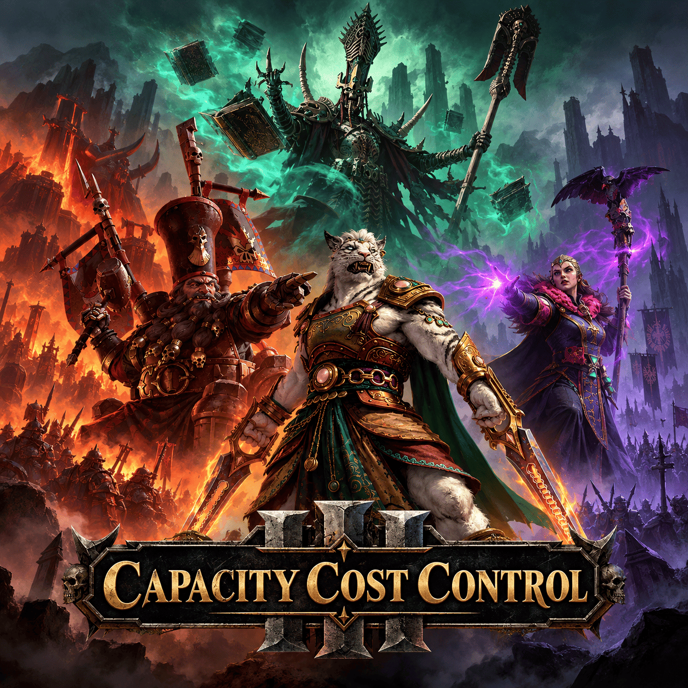

# 兵种容量费用无递增

**为《全面战争：战锤 III》提供可配置的容量购买费用**

[English](README.md) · [简体中文](README.zh-CN.md)

[安装](#安装) · [配置](#配置) · [文档](docs/index.zh-CN.md) · [更新日志](CHANGELOG.md) · [许可证](#许可证)

支持**纳迦什、混沌矮人、上阳诸军、野兽人和帝国紫晶兵**，其中野兽人覆盖兵种及三类英雄容量仪式。仅调整玩家的费用递增，保留容量购买、解锁、招募和军队容量推进。

## 安装

1. 按[开发指南](docs/development.zh-CN.md)构建 `build/tww3_mod_capacity_cost_control.pack`。
2. 复制到游戏 `data` 目录，在官方启动器启用。
3. 安装并启用 [MCT](https://github.com/chadvandy/mct_wh3) 后配置；没有 MCT 时沿用原版费用。
4. 停用其它修改相同仪式、费用 bundle 或军队容量机制的包。

## 配置

各派系独立设置，**默认启用 0%**，也可选择 5%、10% 或自定义正数。费率按基础费用线性增长，例如基础费用 100、费率 10% 时为 `100 → 110 → 120`。战役中途修改会按累计购买次数重新计价。

旧档自动导入旧版模组的 MCT 设置及紫晶兵、上阳诸军、野兽人购买次数，已有新版记录优先保留。无法恢复的历史以接入时为新基线。紫晶兵和上阳诸军依赖本模组的独立计数；恢复原版费用应在 MCT 关闭覆盖，直接卸载可能使历史回退。迁移后建议另存新文件，保留原档。

反馈时请附派系、容量项目、MCT 设置、界面标价和实际扣款。按需启用诊断，日志位于游戏根目录的 `tww3_mod_capacity_cost_control_log.txt`。

## 许可证

Original project code is licensed under the [Aladdin Free Public License, Version 9 (AFPL v9)](LICENSE). Third-party materials retain their original rights.
